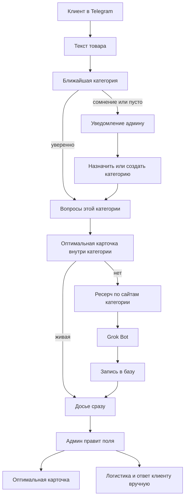

# MVP: поиск завода и сравнение цен

Первая версия проверяет одну гипотезу: новый товар один раз исследуется подробно, а каждый следующий похожий запрос в той же категории закрывается сохранённой карточкой. Сайт, автоматическая логистика и автоматический ответ клиенту в эту версию не входят. Telegram — интерфейс клиента и админа.

Клиент пишет, что хочет купить. Сервис относит текст к ближайшей категории. У категории в базе уже лежат вопросы, которые важно задать, и площадки, где по этому виду товара реально искать завод и цену. Если категория ясна, бот задаёт только её вопросы, собирает бриф и дальше либо отдаёт оптимальную карточку, либо запускает ресерч по её сайтам. Если категория неясна или ни одна не подошла, клиенту уходят обычные вопросы, а админ получает уведомление. Админ назначает существующую категорию или заводит новую. После этого бот задаёт уже вопросы выбранной категории и идёт на её площадки.

Скорость важна на повторе внутри категории. Первый проход по новому товару может идти десятки минут. В базу пишется весь проход. Контакт и цена без адреса страницы не принимаются. Письмо заводу и клиенту пишет человек.

## Категории: как понять товар, что спросить и где искать

Категория — карточка в базе, а не свободный ответ модели на каждый запрос. Модель только выбирает ближайшую из уже заведённых. Вопросы и сайты она не выдумывает: они записаны у категории заранее, и админ их правит.

В первой версии семь категорий:

- Одежда
- Авто
- Электроника и гаджеты
- Оборудование, станки и запчасти
- Дом, косметика и хозтовары
- Стройматериалы и фурнитура
- Общее

«Общее» само не подставляется при сомнении. Туда заявка попадает только если админ так решил.

У каждой категории в базе есть:

- Название, короткое описание и вектор этого описания вместе с примерами товаров. По вектору «Chery Tiggo 7 Pro» оказывается ближе к авто, а «лабораторные халаты» — к одежде.
- Примеры фраз и синонимы, которые админ дописывает: «тигго», «tiggo», «халат лабораторный», «спецодежда». Точное совпадение с примером сразу выбирает категорию.
- Базовые вопросы клиенту: текст, обязательность, тип ответа, варианты, подсказка.
- Пакеты вопросов внутри категории. Пакет включается, когда товар внутри уже выбранной категории уточняется ещё уже. Для халата внутри одежды включается пакет спецодежды. Для платья остаётся база одежды. Сомнение между пакетами админу не шлётся: категория уже известна, бот задаёт базовые вопросы.
- Площадки по ролям: контакт завода или дилера, цена в Китае, розница России, опт России. У площадки есть приоритет, нужен ли вход в аккаунт, и шаблон запроса. Площадка с низким приоритетом в проход не берётся, даже если она полезна для другой категории.
- Смысл нижней цены. У одежды это ступень завода на объём. У автомобиля это цена дилера или производителя в Китае на комплектацию, а не минимальная партия с 1688.

Поиск оптимальной карточки идёт внутри выбранной категории. Карточка халатов не предлагается на автомобиль.

### Как выбирается категория

1. Совпадение с примером или синонимом, который уже лежит у категории.
2. Если примера нет, сравнение вектора фразы клиента с векторами категорий.
3. Категория принимается, когда лучшая заметно впереди второй. Порог настраивается на живых фразах. Рядом хранятся оценки, чтобы порог потом сдвинуть.
4. Иначе заявка встаёт на паузу. Ресерч не стартует. Вопросы этой категории клиенту ещё не задаются.

Клиент при паузе видит: запрос принят, менеджер уточняет, как его лучше искать. Админ видит текст, фото, три ближайшие категории с оценками и кнопки: назначить одну из них, выбрать любую существующую, создать новую. Назначение дописывает фразу клиента в примеры категории, и в следующий раз та же формулировка находится сразу. Новая категория перед продолжением заявки получает имя, описание, несколько примеров, базовые вопросы и список площадок. Площадки и вопросы можно скопировать с соседней категории и поправить.

Если категория выбрана уверенно, клиент видит одну строку «ищу это как автомобиль» и дальше вопросы категории. Фраза клиента «это не автомобиль» возвращает заявку админу тем же способом, что и сомнение.

Фраза «запчасти на Tiggo» близка и к авто, и к оборудованию с запчастями. Разрыв маленький, поэтому её решает админ, а не автомат.

### Одежда

Базовые вопросы: что именно за изделие, количество, материал, размерный ряд и доли размеров, цвет, нужен ли свой крой или логотип, какая цена в России уже попадалась, город доставки.

Пакет «спецодежда и лабораторные халаты» включается на словах вроде халат, лабораторный, медицинский, спецодежда, СИЗ. Дополнительно: многоразовый или одноразовый, плотность ткани, мужской, женский или унисекс, нужен ли сертификат или стандарт.

Площадки контакта и заводской цены: 1688 с поиском фабрик, свой сайт завода, Alibaba, Made-in-China, Global Sources, 慧聪网, каталоги вроде 顺企网, кластеры текстиля Цзянсу, Чжэцзян, Гуандун. Открытая китайская витрина: Taobao и AliExpress, низкий приоритет, только как розничный ориентир. Россия: Wildberries, Ozon, оптовые страницы по запросу «опт».

Проход на халаты: категория одежда, пакет спецодежды, вопросы про ткань, плотность и одноразовость, затем ресерч по фабрикам текстиля. Taobao в этом проходе остаётся витриной цены, не источником телефона завода.

### Авто

Базовые вопросы: новая или с пробегом, марка и модель, год, комплектация, двигатель, цвет, сколько машин, город в России, бюджет или цена, которую клиент уже видел в России. Для пробега дополнительно: пробег, число владельцев по объявлению, город стоянки в Китае.

«Chery Tiggo 7 Pro» совпадает с примерами категории авто и с маркой в описании. Пакет «легковой автомобиль» включается сам. Первым вопросом остаётся «новая или с пробегом», потому что от этого зависят площадки внутри той же категории.

Площадки новой машины в Китае: Автохоум (汽车之家), Дунчэди (懂车帝), Ичэ (易车), Пасифик Авто (太平洋汽车), сайт производителя и дилерские цены, запросы про экспортную комплектацию. Площадки с пробегом: Гуацзы (瓜子), Че168 и раздел пробега Автохоум. 1688 и Taobao для целой машины в список почти не входят: там мало предложений автомобиля. Их можно оставить с пометкой «не использовать для целой машины». Россия: Авто.ру, Дром, раздел автомобилей Авито. Wildberries и Ozon для целой машины не используются.

Нижняя цена в досье по авто — цена дилера или официального прайса в Китае на названную комплектацию. Рядом цена тех же площадок России. Логистика, утильсбор и оформление по-прежнему вручную у менеджера, в автоматический вердикт не входят.

### Электроника и гаджеты

Вопросы: точная модель, новая или уценённая, количество, ключевые характеристики, нужна ли конкретная ревизия или регион прошивки, вилка и напряжение, какая цена в России уже есть, город.

Площадки: 1688 и Alibaba как опт, сайт бренда и официальный магазин, JD и Taobao как китайская розница, Made-in-China для партий без розничного бренда. Россия: Wildberries, Ozon, DNS, М.Видео, Ситилинк. Для электроники в скилле отдельно усилена проверка «завод или перекуп»: в этой категории торговых витрин больше, чем цехов.

### Оборудование, станки и запчасти

Вопросы: тип и модель, новое или б/у, количество, питание и мощность, нужные стандарты, нужен ли монтаж словами клиента, город, известная цена в России. Для запчасти: к какому станку или машине, артикул, оригинал или аналог.

Площадки: Made-in-China, Alibaba, 1688, 慧聪网, сайты производителей станков, каталоги запчастей. Россия: Пульс цен, промышленные объявления Авито, сайты отраслевых поставщиков. Розничные маркетплейсы одежды и электроники здесь вторичны.

Запчасть автомобиля попадает сюда, когда админ так назначил сомнительную фразу, либо когда в тексте явно артикул и слово «запчасть», а до категории авто далеко по оценке.

### Дом, косметика и хозтовары

Вопросы: что за продукт, объём упаковки, количество, бренд или без бренда, для косметики состав и срок годности, если клиент их знает, нужен ли сертификат словами клиента, город, известная цена.

Площадки: 1688, Taobao, Alibaba, Made-in-China, сайты фабрик бытовой химии и упаковки. Россия: Wildberries, Ozon, профильные сети вроде Золотого яблока для косметики. Наличие сертификата бот у клиента спрашивает и в досье переносит. Сам документ и допуск к продаже менеджер проверяет вручную.

### Стройматериалы и фурнитура

Вопросы: материал, размер или сечение, единица (штука, метр, м², тонна), сорт или стандарт, количество, город, известная цена.

Площадки: 1688, Made-in-China, Alibaba, 慧聪网, сайты заводов металла, плитки, фурнитуры. Россия: Петрович, Лемана Про, Пульс цен, Wildberries там, где товар вообще есть в рознице.

### Общее

Вопросы короткие: что это, количество, фото или ссылка, характеристики своими словами, известная цена, город. Площадки широкие: обычный поиск в интернете, 1688, Alibaba, Wildberries. Категория нужна, чтобы заявка могла поехать дальше, пока узкой категории нет. Следующий такой же товар админ уже заводит отдельной категорией, а не копит в «общем».

## 1. Поиск прямых заводов

Способ поиска тот же, что отдавал контакты у GPT: веер запросов на языке источника и открытие страниц, где телефон, почта и цена лежат текстом. Меняется набор сайтов. Его приносит категория, а не общий список на все товары.

Шаблоны запросов остаются общими и подставляют название из брифа:

- Китайский: `{товар} 生产厂家`, `{товар} 工厂 联系方式`, `{товар} 厂家 电话`, `{товар} 源头工厂`.
- Английский: `{product} manufacturer contact`, `{product} factory price MOQ`.
- Русский: `{товар} цена`, `{товар} оптом`.

Для авто те же шаблоны получают другие слова и другие сайты: «奇瑞 瑞虎7 Pro 经销商 报价», «Chery Tiggo 7 Pro цена», и открываются Автохоум и Авто.ру, а не фабричный поиск халатов. Для халатов остаются «实验室白大褂 生产厂家» и текстильные площадки.

Дальше по каждой годной странице снимаются имя, контакт, цена, партия или комплектация, город и цитата со ссылкой. Реестр по коду компании включается там, где найденное лицо — китайская компания: единый социальный кредитный код, имя, статус, адрес, сфера. Для дилерской цены автомобиля код нужен, когда в объявлении есть юридическое имя. Российский ИНН снимается с карточки российского продавца, когда она его показывает.

Почему цена завода или дилера ниже витрины. Страница производителя показывает свою ступень цены, витрина перекупа и розница уже с наценкой. В досье это разные слои. Число без цитаты и ссылки в базу не пишется.

Что зафиксировано: площадки и смысл «заводской» цены приходят из категории; схема GPT применяется к этому списку; 1688 и Taobao обязательны для одежды и расходников и почти не используются для целого автомобиля.

## 2. Скилл исследователя

Скилл один и общий: как отличить завод от торговца, как цитировать страницу, что нельзя делать без человека. Список сайтов, вопросы и уже данные ответы в скилл не зашиты. Их сервис передаёт в запуске из категории.

Последовательность:

1. Если в запуске лежит живая оптимальная карточка, интернет не открывать.
2. Прочитать ответы клиента и минус-слова, которые появились из вопросов категории.
3. Собрать веер запросов и открыть площадки в порядке приоритета категории. Площадку, которой в списке нет, не добавлять от себя.
4. Снять контакты, цены и цитаты. Роль компании оценить по правилам ниже.
5. Для лидеров с китайским юридическим именем сверить реестр.
6. Вернуть JSON на адрес приёма базы.

Правила роли:

- В сфере деятельности есть производство этой категории — признак завода. Только продажа и импорт-экспорт — торговля.
- «商贸 / 贸易 / 供应链 / 电子商务» в имени — торговый контур. «厂 / 制造» на вывеске само по себе слабый плюс.
- Метка фабрики на 1688 усиливает вывод вместе с реестром. Для авто этой метки обычно нет, и вывод строится по дилеру, прайсу производителя и реестру.
- Узкая витрина, адрес в промзоне и число застрахованных поднимают балл завода. Офисная башня и каталог несвязанных товаров его опускают.
- Статус лицензии «действует». Погашенная лицензия убирает кандидата из короткого списка.
- Имена на сайте, в реестре и на лицензии сходятся. Расхождение помечается «роли не сверены».

Четыре исхода: прямой производитель; производитель с экспортной компанией; торговая компания; роли не сверены. Для автомобиля к ним добавляется исход категории «дилер или официальный прайс», если площадка автомобильная и завода на странице нет.

Запреты: не писать заводу и клиенту, не оформлять заказ, не обходить капчу, не подставлять телефон или цену без URL.

Что зафиксировано: правила роли общие; сайты и бриф приходят из категории на каждый запуск.

## 3. База и оптимальная карточка

Таблицы хранят цены, коды, контакты и выбор админа. Вектор лежит на описании категории, на примерах фраз и на тексте товара. Цена в вектор не кладётся.

Сущности:

- **Категория, примеры фраз, вопросы, пакеты вопросов, площадки.** Это справочник, который админ редактирует.
- **Заявка.** Текст, фото, выбранная категория, пакет, ответы, оценки классификации, статус паузы.
- **Канонический товар** внутри категории.
- **Компания, витрина, найденное предложение, снимок рынка.** Сырьё ресерча со ссылками и датами.
- **Оптимальная карточка.** Лучший вариант, который админ подтвердил. Привязана к категории и к диапазону объёма или, для авто, к модели и комплектации.
- **Ручная экономика.** Курс, логистика, пошлина, наценка, цена клиенту.

Поля оптимальной карточки админ правит сам. Общие: кто продавец, контакты со ссылкой или пометкой «вписано админом», цена, срок жизни карточки, заметка почему этот вариант лучший. Поля товара берутся из вопросов категории: у халата это ткань и плотность, у Tiggo это год и комплектация. Так карточка совпадает с тем, что бот в следующий раз спрашивает у клиента.

Порядок на новой заявке, когда категория уже назначена:

1. Живая оптимальная карточка той же категории и тех же обязательных ответов — отдать её сразу.
2. Иначе полный ресерч по площадкам категории и запись всех находок.
3. Админ помечает карточку оптимальной явно. Сама запись ресерча этого не делает.

Срок по умолчанию: 30 дней на заводскую или дилерскую цену и контакты, 14 дней на рыночный снимок.

## 4. Три цены

Слои не склеиваются в одну цифру. Какие площадки кормят каждый слой, решает категория.

- **Россия.** Розница и, где есть, опт. Одежда: Wildberries, Ozon, опт. Авто: Авто.ру, Дром, Авито Авто. Электроника добавляет сети техники. Стройка добавляет строительные сети.
- **Открытый Китай.** То, что клиент мог бы увидеть сам: для одежды Taobao и витрина 1688, для авто публичный прайс Автохоум или Дунчэди.
- **Нижняя закупка.** Для одежды и расходников — ступень завода на объём. Для целого авто — цена дилера или производителя на комплектацию. Для запчасти — цена завода или оптовика на артикул.

Единицы не усредняются: штука, набор, машина, метр. Грубая похожесть по одной только категории в медиану не входит. Пересчёт в рубли по курсу на дату снимка справочный. Вердикт, что клиенту так дешевле, чем купить в России, появляется после ручных полей логистики.

## 5. Grok Bot

Подробный ресерч нового товара делает [Grok Bot](https://cursor.com/docs/grok-bot) на своём облачном компьютере с браузером. Логины сохраняются. Аккаунты площадок живут на отдельном пользователе Cursor, только под закупки. Пароль, код и капчу вводит человек. Если китайский сайт не открывается с облачной сети, трафик идёт через компьютер админа в Китае.

Запуск с нашего сервиса — webhook с телом заявки. Ответ 200 означает, что прогон начался. Досье готово, когда JSON пришёл на наш приём. В теле запуска: категория, пакет, ответы клиента, упорядоченный список площадок, шаблоны запросов, адрес приёма. Бот открывает этот список. Площадку вне списка он не устраивает самостоятельно.

В браузере заранее входят те аккаунты, которые нужны сеянным категориям: 1688 и Taobao для одежды, электроники и расходников, Авито для российского слоя, автомобильные кабинеты только если без них цена закрыта. Целая машина ищется с открытых автомобильных сайтов и из этого списка.

Скилл после удачного прохода сохраняется у бота. Показ своего поиска в браузере, если доступен Teach a task, даёт черновик на десять минут, и его дополняют правилами цитат и запретом писать наружу.

## Скилл Cursor, который доспрашивает

Это личный скилл редактора, не часть бота и не про категории, площадки или план. Он лежит в `~/.cursor/skills/detail-interview/` и в любом проекте задаёт один-два уточняющих вопроса, пока просьба не станет конкретной. К Telegram-клиенту он не обращается.

Каталоги, которые имеет смысл смотреть, и как скилл вообще попадает в Cursor:

- Официальное описание формата: [документация Cursor](https://cursor.com/docs/skills). Скилл — папка с `SKILL.md`. Проект читает `.cursor/skills/` и `.agents/skills/`. Личная папка на компьютере — `~/.cursor/skills/`. В чате скилл вызывается через `/`. Чтобы он держался всю сессию, его включают как свой режим.
- Каталог с командой установки: [skills.sh](https://www.skills.sh). Команда вида `npx skills add владелец/репозиторий --skill имя -a cursor` копирует папку в проект. Перед установкой читается сам `SKILL.md`: чужой скилл может содержать скрипты, и агент их запускает.
- Подборки на GitHub, откуда берут ссылки, а не ставят всё подряд: [mattpocock/skills](https://github.com/mattpocock/skills), [awesome-cursor-skills](https://github.com/spencerpauly/awesome-cursor-skills), [awesome-agent-skills](https://github.com/VoltAgent/awesome-agent-skills). В самом Cursor чужой репозиторий ставится как плагин, если в нём есть `.cursor-plugin/marketplace.json`. Обычную папку со скиллом плагин-маркет сам не подхватывает.
- `gh skill install владелец/репозиторий --agent cursor` делает ту же установку из GitHub.

Готовые скиллы «задай вопросы» есть, и ни один не закрывает эту работу как есть:

- `grill-me` и `grilling` у Мэтта Покока. Близко по смыслу: интервью, пока не останется ни одного молчаливого решения, у каждого вопроса есть рекомендуемый ответ, «да» этот ответ принимает. Скилл включается только командой `/grill-me`, сам в обычном разговоре не просыпается. За один круг задаёт все вопросы, которые уже можно задать, пачкой.
- `clarify` в репозитории mwenglein/skills. Допрашивает про боль пользователя и сценарий и специально не трогает устройство системы, базу и площадки. Нам как раз нужно доспрашивать устройство.
- `requirements-clarifier` задаёт один вопрос за раз и не идёт в код, пока тема мутная. Мало известен, завязан на свой набор оценок.
- `speckit-clarify` задаёт не больше пяти вопросов и требует структуру Spec Kit. Для «максимально подробно» потолок в пять вопросов мал.

Команда `/detail-interview` включает его явно. Когда сказано делать, вопросы прекращаются.

## skills/

Скиллы ниже подключаются к проекту позже, когда настраивается рабочее место программиста. Сейчас их не ставить и к боту клиента не привязывать. Команды запускать из корня проекта, в новый чат, после того как папка со скиллом появилась.

- Поиск других готовых скиллов: `npx skills add https://github.com/vercel-labs/skills --skill find-skills`
- Допрос решения до сборки: `npx skills add https://github.com/mattpocock/skills --skill grill-me`
- Работа агента в браузере: `npx skills add https://github.com/vercel-labs/agent-browser --skill agent-browser`

`grill-me` тянет соседний скилл `grilling` из того же репозитория. Если после установки `/grill-me` не находит процедуру, вторым шагом ставится `--skill grilling` из `https://github.com/mattpocock/skills`.

## Репозитории поиска

Каждый репозиторий потом читается отдельно: как запускается, есть ли свой HTTP API, какие поля отдаёт, что повторяет сосед. На VPS поднимается не весь список. Общего открытого HTTP API ни у одного из них нет. Свой бэкенд будет вызывать команду или локальный процесс и забирать JSON. Чужой платный ключ для этого шага не нужен.

На одной площадке держится один браузер и один профиль. Два парсера одного и того же сайта на одной машине делят капчу и сессию. Капчу и QR вводит человек. Авито и часто Ozon с адреса датацентра не открываются: им нужен российский IP, домашний или выход через машину в России.

### Китай, что поднимать

- [1688-cli](https://github.com/superjack2050/1688-cli) — основной процесс для 1688. Это команда, не сервер. `1688 supplier search --factory-only --json` ищет фабрики отдельным поиском компаний, а не склеивает их из товарных карточек. Фильтры: провинция, город, стаж, повторные покупки, скорость ответа. `1688 search` и `1688 offer` дают карточки и лестницу цен, `1688 image-search` ищет по фото. Под капотом Chrome и постоянный профиль `~/.1688/`. На VPS бэкенд вызывает команду и читает JSON. Корзина, оплата и чат с продавцом в наш контур не входят.
- [made-in-china-scraper-example](https://github.com/wfgsss/made-in-china-scraper-example) — второй процесс, только для Made-in-China. Читает страницу выдачи: название, цена, минимальная партия, компания, город, тип «завод или торговая», отметка проверки. Страницу товара не открывает, там капча. Своего API нет, это скрипт сбора. Поднимать, когда дойдём до этой площадки, и смотреть, как поле типа компании ложится в нашу роль «завод / торговец».
- [china-wholesale-scraper-toolkit](https://github.com/wfgsss/china-wholesale-scraper-toolkit) — тот же автор и тот же сбор Made-in-China плюс Yiwugo и DHgate. Отдельным сервисом не поднимать: Made-in-China уже покрыт примером выше. Репозиторий читается, чтобы решить, нужны ли мелкий опт Yiwu и DHgate. Для заводской цены они вторичны.
- [1688-Scraper-MCP](https://github.com/xiayumu034-crypto/1688-Scraper-MCP) — тот же 1688, что и 1688-cli: поиск, фильтр фабрики, лестница цен, проверка поставщика. Отличие в оболочке: MCP на Python и браузер DrissionPage, в модель уходит короткая пачка из нескольких карточек. Второй браузер 1688 на VPS не запускать. Из него забирается приём «отрезать торговцев и чужой город до того, как текст попадёт в модель». Поиск фабрик через company search остаётся в 1688-cli: MCP собирает фабрики из товарной выдачи, а это как раз более слабый путь.

Итого на машине для Китая: 1688-cli и, отдельно, сборщик Made-in-China. Остальные два репозитория — чтение, не процесс.

### Россия, что поднимать

Готовые проекты на те же площадки, что уже записаны в плане:

- [marketplace-mcp](https://github.com/YegorMy/marketplace-mcp) — один локальный MCP на Ozon, Wildberries, Яндекс Маркет и Авито. Поиск, карточка по ссылке, короткие отзывы, сравнение. Авито включается отдельно. Если площадка закрывается, инструмент пишет об этом и не обходит защиту. Своего публичного API нет: это процесс, который агент или бэкенд вызывает у себя.
- [ru-marketplace-mcp](https://github.com/Vladimir-Human/ru-marketplace-mcp) — те же четыре площадки плюс DNS, Ситилинк, Lamoda, Детский мир и ещё Taobao. Wildberries и Яндекс Маркет читаются обычным HTTP без браузера. Ozon и Авито идут через Chrome. Авито с датацентрового IP блокируется, с российского домашнего читается, если не частить. Taobao здесь пересекается с китайским контуром, для заводов 1688 он не замена.
- [marketplaces-mcp-ru](https://github.com/ilyautov/marketplaces-mcp-ru) — API кабинета продавца: свои заказы, остатки и цены своего магазина. Поиск чужих карточек на витрине он не делает. Для сравнения рынка его не поднимать.
- [SeleniumParser](https://github.com/yaroniks/seleniumparser) и [marketplace-parser](https://github.com/krein15/marketplace-parser) повторяют Wildberries, Ozon и Яндекс Маркет. Первый — учебный скрипт, Ozon в нём уже не работает. Второй — программа под Windows и Excel, не сервис на VPS. Оба не ставить рядом с MCP.
- Авто.ру и Дром в этих MCP нет. [parser-daa-tg-bot](https://github.com/BottecRu/parser-daa-tg-bot) читает Авито, Дром и Авто.ру, но это бот мониторинга новых объявлений, и Авито в нём повторит marketplace MCP. [auto-ru-parser](https://github.com/vavilovnv/auto_ru_parser) пишет CSV по Авто.ру и упирается в ручную капчу. Старый [autoparser](https://github.com/tarbagan/autoparser) 2020 года не брать за основу. Для категории «Авто» читать `parser-daa-tg-bot` как образец полей Дрома и Авто.ру, а живой Авито оставить одному российскому MCP.

Два российских MCP на четыре одни и те же витрины вместе не поднимать. Сначала читаются оба. К запуску выбирается один: `ru-marketplace-mcp`, если нужны и сети техники, и российский IP под Авито и Ozon; `marketplace-mcp`, если достаточно четырёх площадок и явного отказа, когда сайт закрылся. Авто.ру и Дром после этого остаются отдельным маленьким читателем, без второго сборщика Авито.

## Как этим пользуются

Клиент пишет свободным текстом и прикладывает фото, если оно есть. При ясной категории отвечает на её вопросы. При сомнении ждёт, пока админ назначит категорию, и затем отвечает уже на её вопросы.

Админ на сомнении выбирает категорию или создаёт новую. На готовом досье правит поля и помечает оптимальную карточку. Потом вписывает логистику и сам отвечает клиенту. Новую категорию он собирает из имени, примеров фраз, вопросов и площадок. Следующий похожий текст на неё уже садится сам.

## Порядок сборки

Справочник категорий и пауза с уведомлением админа: на фразах «Chery Tiggo 7 Pro» и «лабораторные халаты» категория, вопросы и список сайтов должны различаться, а на фразе «запчасти на Tiggo» должна появиться карточка сомнения. Затем приём досье и оптимальная карточка внутри категории. Затем скилл и webhook, которому уходит уже выбранный список сайтов. Первый боевой ресерч — халаты, второй — один автомобиль, чтобы проверить, что проход не ушёл на Taobao за целой машиной.

Перед кодом нужны id Telegram админов и отдельный пользователь Cursor под бота и аккаунты площадок.
