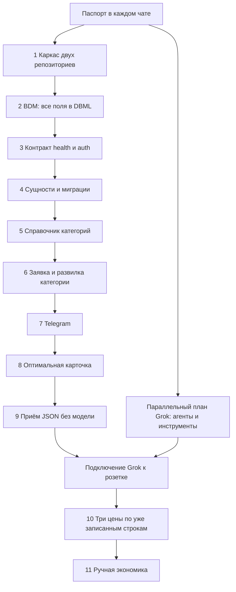

> **Устарело.** Здесь JWT-вход, pgvector и слои manufacturing. Рабочий план — [редакция 1.3](web-rework-1.3.md): образец кода — sekvoiya, не manufacturing. Продукт — Word редакции 1.2 в `Finder-materials`. Этот файл не удалять.

---
name: Finder MVP tech
overview: "Технический план до первого MVP: отдельный репозиторий OpenAPI, бэкенд NestJS по слоям manufacturing без предметной области производства, отдельный этап BDM на английских полях и самодостаточный промт на каждый этап."
todos:
  - id: stage-1-skeleton
    content: Каркас api-contract и backend по слоям manufacturing, health и contract:sync
    status: pending
  - id: stage-2-bdm
    content: "DBML всех сущностей MVP: английские поля и русское зачем"
    status: pending
  - id: stage-3-auth
    content: Контракт входа админа и JWT
    status: pending
  - id: stage-4-migrations
    content: Сущности MikroORM, pgvector и миграции из DBML
    status: pending
  - id: stage-5-categories
    content: CRUD категорий, вопросов, пакетов и площадок
    status: pending
  - id: stage-6-inquiry
    content: Заявка, классификация, пауза и назначение категории админом
    status: pending
  - id: stage-7-telegram
    content: "Telegram: вопросы клиенту и кнопки админа"
    status: pending
  - id: stage-8-optimal
    content: Оптимальная карточка и ответ из базы без ресерча
    status: pending
  - id: stage-9-research
    content: Только приём JSON в ResearchRunner. Модель, Grok и GitHub-сборщики — отдельный план после этапов 1–8 и этой розетки
    status: pending
  - id: stage-10-11-prices
    content: Три ценовых слоя и ручная экономика без автоответа клиенту
    status: pending
isProject: false
---

# Технический план до первого MVP

Продуктовые решения уже лежат в [плане MVP](/Users/fs/.cursor/plans/mvp_sourcing_bot_c384d49e.plan.md). Этот документ — порядок кода и промт на каждый этап. Один этап кидается в пустой чат целиком: сначала паспорт, потом блок этого этапа. Большой этап можно разрезать по подпунктам «Как дробить» и собрать из него свой план.

Шаблон слоёв — [manufacturing-management](/Users/fs/DailyCar/backend/manufacturing/manufacturing-management), описание в [ARCHITECTURE.md](/Users/fs/DailyCar/backend/manufacturing/manufacturing-management/docs/architecture/ARCHITECTURE.md). Контракт — соседний репозиторий, как [manufacturing-management-api-contract](/Users/fs/DailyCar/backend/manufacturing/manufacturing-management-api-contract), правила связи — [CONTRACT_FIRST.md](/Users/fs/DailyCar/backend/manufacturing/manufacturing-management/docs/architecture/CONTRACT_FIRST.md). Станки, задания, роли SUPERVISOR и WORKER не переносятся.



## Паспорт

Его вставляют в начало каждого пустого чата без сокращений.

```text
Проект Finder. Бэкенд ищет завод и сравнивает цены для менеджера. Клиент пишет в Telegram. Сервис относит текст к категории. У категории свои вопросы и площадки. Уверенное совпадение идёт дальше. Сомнение останавливает ресерч и зовёт админа: он назначает категорию или создаёт новую. Если в этой категории есть живая оптимальная карточка, её отдают сразу. Иначе идёт ресерч, админ помечает лучший вариант. Логистику и ответ клиенту считает человек. Автоматического коммерческого предложения нет.

Репозитории рядом:
- api-contract: единственная правда HTTP. OpenAPI, версии тегами.
- backend: NestJS 11, Fastify, MikroORM, PostgreSQL, pgvector. Слои src/domain, src/application, src/infrastructure, src/interfaces, src/common, src/migrations. Зависимости: interfaces → application → domain ← infrastructure. Типы из generated только в interfaces. В domain и application своих типов. Ответ API: единый ApiResponse. Ошибки: AppErrors → фильтр. Валидация запросов: AJV по openapi.json. Контракт подтягивается scripts/contract-sync.sh по CONTRACT_REPO и CONTRACT_VERSION.

Имена таблиц, колонок, типов и кода на английском. Пояснения в DBML, комментарии к полям и тексты для человека на русском.

Роли MVP: ADMIN и CLIENT. Вход клиента — Telegram user id. Вход админа — учётка, засеянная в базу, JWT. Отдельной регистрации нет.

Чего не делать: не копировать сущности manufacturing (task, station, conveyor, supervisor, worker). Не ставить второй браузер на один и тот же сайт. Не писать клиенту коммерческое предложение из бота. Не обходить капчу. Не поднимать marketplaces-mcp-ru: это кабинет продавца, не поиск чужих карточек.

Если для этого этапа не хватает одного решения, задай один вопрос, дай рекомендуемый ответ и остановись. «Да» принимает рекомендацию. Не выдумывай молча.
```

## 1. Каркас двух репозиториев

Снять с manufacturing устройство папок, скрипт контракта, Docker Compose для Postgres, логер, конверт ошибок и пустой модуль. Доменных таблиц ещё нет.

Как дробить: 1a только backend компилируется и поднимает пустую БД. 1b только api-contract с `/health` и тегом `v0.0.1`. 1c `contract:sync` в backend.

```text
Паспорт Finder выше.

Этап 1. Каркас.
Сейчас оба репозитория пустые. Рабочая папка Finder.
Сделай два репозитория по образцу /Users/fs/DailyCar/backend/manufacturing/manufacturing-management и manufacturing-management-api-contract.
Backend: NestJS 11, Fastify, MikroORM, Postgres в docker-compose, слои domain / application / infrastructure / interfaces / common, скрипты build, typecheck, lint, migration:*, contract:sync, test.
Api-contract: openapi.yaml, README как подключать тег, CHANGELOG. Первый тег v0.0.1 содержит только GET /health.
Backend по тегу получает api/openapi.yaml, api/openapi.json и src/interfaces/http/generated. Generated не править руками.
Перенеси механизм ошибок и ApiResponse по образцу manufacturing, без его сущностей.
Готово, когда: docker compose поднимает Postgres, backend стартует, GET /health отвечает конвертом ApiResponse, typecheck пустой.
Не делай таблицы Finder, Telegram, парсеры и JWT-логин. Это следующие этапы.
```

## 2. BDM

Отдельный этап на все поля. Артефакт — DBML, как [schema.dbml](/Users/fs/DailyCar/backend/manufacturing/manufacturing-management/docs/database/schema.dbml): `backend/docs/database/schema.dbml` плюс `enums/` и `tables/`. Код сущностей и миграции сюда не входят. У каждого поля: имя на английском, тип, null, unique, FK, delete rule, русская строка «зачем».

Сущности, которые обязаны появиться. Пустой чат расписывает колонки, а не список заново:

- `app_user`: роль ADMIN или CLIENT, telegram user id, признак админа.
- `category`: имя, описание для вектора, статус. Семь стартовых не заполнять данными, только схема.
- `category_phrase`: пример фразы и синоним, привязка к категории. Точное совпадение выбирает категорию.
- `category_question`: текст, обязательность, тип ответа, варианты, порядок. `question_pack_id` пустой, если вопрос базовый.
- `question_pack`: уточнение внутри категории. Сомнение между пакетами админу не уходит.
- `category_site`: роль площадки FACTORY_CONTACT, CHINA_OPEN_PRICE, RUSSIA_RETAIL, RUSSIA_WHOLESALE, приоритет, нужен ли логин, шаблон запроса, заметка, что площадку не использовать для части товаров.
- `inquiry`: сырой текст, фото, статус, выбранные category и pack, оценки классификации, флаг паузы.
- `inquiry_answer`: ответ на вопрос категории.
- `canonical_product`: товар внутри категории, русское и китайское нормализованное имя.
- `company`: китайское юридическое имя, unified social credit code, статус реестра, адрес, сфера, число застрахованных.
- `storefront`: площадка, id продавца, ссылка, метки фабрики, город.
- `offer`: цена, валюта, ступень объёма, минимальная партия, цитата, url, роль DIRECT_FACTORY, FACTORY_WITH_EXPORTER, TRADER, UNVERIFIED, DEALER_OR_LIST_PRICE, дата съёма. Строка без url невалидна.
- `market_snapshot` и примеры внутри снимка: слой RUSSIA_RETAIL, RUSSIA_WHOLESALE, CHINA_OPEN, источник, медиана, разброс, дата. Срок годности в схеме: снимок 14 дней, заводская цена и контакты 30 дней. Это поля даты, не код.
- `optimal_card`: одна живая на канонический товар и диапазон объёма. Пометка ставит только админ. Прошлые остаются историей. Контакты: значение, канал, url или пометка admin_entered и дата.
- `manual_economics`: курс, логистика, пошлина, наценка, цена клиенту. Пустые поля значат, что вердикта «выгодно» ещё нет.
- `research_run`: источник, статус, ссылка на прогон, причина срыва.
- Векторы: колонки pgvector на описании категории, фразе и тексте товара. Цену в вектор не класть.

Как дробить, если этап большой: 2a пользователи и категории с вопросами и площадками. 2b заявка и ответы. 2c компания, витрина, оффер, снимок рынка. 2d оптимальная карточка, экономика, прогон ресерча, векторы. Каждый подэтап получает паспорт и только свой список сущностей, плюс фразу «остальные таблицы не трогай».

```text
Паспорт Finder выше.

Этап 2. BDM.
Кода и миграций не пиши. Результат: backend/docs/database/schema.dbml и файлы enums/ и tables/ в том же стиле, что /Users/fs/DailyCar/backend/manufacturing/manufacturing-management/docs/database/schema.dbml.
Имена английские. У каждого поля тип, null, unique, FK, on delete, и русская строка зачем оно.
Обязательные сущности: app_user, category, category_phrase, category_question, question_pack, category_site, inquiry, inquiry_answer, canonical_product, company, storefront, offer, market_snapshot, optimal_card, manual_economics, research_run. Векторные колонки на category, category_phrase, canonical_product. Цену в вектор не класть.
Offer без source_url невозможен. Optimal_card становится живой только явным флагом админа. На один canonical_product и один диапазон количества одна живая карточка.
Роли поставщика: DIRECT_FACTORY, FACTORY_WITH_EXPORTER, TRADER, UNVERIFIED, DEALER_OR_LIST_PRICE.
Роли площадки: FACTORY_CONTACT, CHINA_OPEN_PRICE, RUSSIA_RETAIL, RUSSIA_WHOLESALE.
Статусы заявки должны отличать черновик, ожидание категории, сбор ответов, ответ из базы, ресерч, досье у админа, закрыто.
Готово, когда по схеме можно нарисовать все связи и нет поля без русской строки.
Не пиши Nest-сущности, SQL-миграции и OpenAPI.
```

## 3. Контракт health и вход админа

После BDM в api-contract появляются только служебные методы. Предметные ручки ждут своих этапов, чтобы контракт не обгонял согласованные поля.

```text
Паспорт Finder выше. BDM уже в backend/docs/database. Таблицу app_user оттуда считай истиной.

Этап 3. Контракт.
В api-contract добавь тег v0.1.0: GET /health, POST /admin/login, POST /admin/refresh. Конверт ApiResponse и формат ошибки как в manufacturing. Пароли в контракте не логируй.
В backend подтяни этот тег через contract:sync. Реализуй логин сид-админа: JWT, guard на все ручки, кроме health и login, роль ADMIN.
Готово, когда админ из сида получает токен, а ручка без токена не открывается.
Не описывай категории, заявки и Telegram.
```

## 4. Сущности и миграции из BDM

```text
Паспорт Finder выше. Истина полей — backend/docs/database. Истина HTTP — текущий тег api-contract. Новые ручки не добавляй.

Этап 4. Схема в Postgres.
По DBML сделай сущности MikroORM, интерфейсы репозиториев в domain, реализации в infrastructure, миграции. Включи расширение vector.
Связи и on delete возьми из DBML. Правило удаления, которого нет в DBML, не выдумывай: остановись и задай один вопрос.
Готово, когда migration:up на пустой базе создаёт все таблицы BDM, а typecheck чистый.
Не пиши бизнес-сценарии, контроллеры предметной области и парсеры.
```

## 5. Справочник категорий

Админ заводит категорию, фразы, вопросы, пакет и площадки. Семь категорий данными не сидить в этом этапе: сид — отдельный проход после того, как ручки стабильны. Если этап раздуется, сид вынести в 5b.

```text
Паспорт Finder выше. Поля category, category_phrase, category_question, question_pack, category_site уже в БД.

Этап 5. CRUD категорий для админа.
Сначала правь api-contract новым тегом: создание и правка категории, фраз, вопросов, пакетов и площадок. Подтяни тег. Потом контроллер, mapper, application-сервис.
Клиент эти ручки не вызывает.
Готово, когда админ через API собирает категорию с одним базовым вопросом, одним пакетом и двумя площадками разной роли, и читает её обратно.
Не классифицируй заявки и не ходи в интернет.
```

## 6. Заявка и развилка категории

Классификация в application: точная фраза, затем вектор. Порог «заметно впереди второй» — настройка, стартовое число вынеси в env и подпиши, что его крутят на живых фразах. При сомнении ресерч не стартует.

```text
Паспорт Finder выше. Справочник категорий уже работает.

Этап 6. Заявка.
Контракт: создать заявку текстом, прочитать её, админские ручки «назначить категорию» и «создать категорию и назначить». Назначение дописывает фразу клиента в category_phrase.
Реализуй классификацию в application. Точное совпадение фразы выше вектора. Уверенное совпадение пишет category_id и просит ответы только на вопросы этой категории и подходящего пакета. Сомнение ставит паузу и не создаёт research_run.
Эмбеддинги спрячь за портом application. В infrastructure пока заглушка с фиксированным вектором и пометкой stub. Какую модель звать по API, в этом этапе не выбирай: это отдельный план после каркаса.
Готово, когда фраза из category_phrase выбирает категорию, неизвестная фраза остаётся в паузе, а назначение админом снимает паузу и сохраняет фразу.
Не подключай Telegram и парсеры.
```

## 7. Telegram

Интерфейсный адаптер. Домен о Telegram не знает.

Как дробить: 7a клиентский диалог. 7b уведомление админа и кнопки назначения.

```text
Паспорт Finder выше. Заявка и развилка категории уже есть в HTTP.

Этап 7. Telegram.
В interfaces добавь бота. Клиент пишет текст и фото. Бот создаёт заявку через application, не через сырой SQL.
При ясной категории бот задаёт вопросы категории по одному и показывает строку, к какой категории отнёс. Фраза «это не та категория» возвращает заявку в паузу.
При паузе клиент видит, что менеджер уточняет направление. Админ получает текст, фото и три ближайшие категории. Кнопки: назначить одну из них, выбрать другую существующую. Создание новой категории с вопросами и площадками в боте может звать уже готовый API этапа 5.
Секреты бота только в env.
Готово, когда два разных текста проходят два разных сценария на тестовом боте: уверенная категория с вопросами и сомнение с кнопкой админа.
Не ищи товары в интернете и не отправляй клиенту цену.
```

## 8. Оптимальная карточка

```text
Паспорт Finder выше. Заявка умеет категорию и ответы.

Этап 8. Оптимальная карточка.
Контракт и сервис: админ создаёт карточку вручную или из оффера, правит поля, ставит единственный флаг «живая». Повторная живая на тот же товар и тот же диапазон количества снимает флаг с предыдущей, строка остаётся.
Поиск перед ресерчем: та же категория, те же обязательные ответы, диапазон количества, дата ещё живая. Тогда research_run не создаётся, заявка получает статус «ответ из базы».
Готово, когда вторая похожая заявка возвращает карточку без ресерча, а заявка с другим объёмом её не берёт.
Не подключай внешние парсеры.
```

## 9. Только розетка для досье

В этом плане ресерч заканчивается на приёме JSON. Кто этот JSON добудет — модель, Grok Bot или команда GitHub-сборщика — сюда не входит.

```text
Паспорт Finder выше. Оптимальная карточка уже перехватывает повтор.

Этап 9. Приём досье.
Порт ResearchRunner. Реализация ingest принимает JSON: компании, офферы, снимки, цитаты и url. Оффер без url отбрасывается и пишется в research_run как причина. Заявка переходит в «досье у админа».
Готово, когда тестовый JSON создаёт company, storefront, offer и market_snapshot, а мусор без url не создаёт offer.
Не вызывай модель, Grok, 1688, браузер и Telegram наружу. Не выбирай провайдера API.
```

## Отдельный план: нейронка, Grok и сборщики

В этапах 1–11 Grok не устанавливается и не настраивается. Для него отдельный план. Его можно писать и обкатывать параллельно с каркасом: установка, агенты, браузер, пробный поиск. В бэкенд Finder он подключается после этапа 9, когда есть розетка JSON. Этапы 10 и 11 можно кодить раньше на тестовом JSON. Живое досье они покажут, когда этот план уже кладёт строки в ту же розетку.

Как этот план начинается. В пустой чат Grok Bot кладётся паспорт проекта из этого документа и продуктовый план. Бот составляет черновик своей настройки: каких агентов завести, куда их подключить, какими инструментами читать китайские и российские площадки, сайты и поисковые выдачи. Черновик остаётся черновиком, пока он не сверен с рамками ниже.

Отдельный план отвечает на четыре вещи:

- Какой вызов по API основной: Grok Bot, API ChatGPT или несколько моделей на разные шаги. Классификация текста, китайские запросы, разбор карточки и объяснение досье могут идти в разные модели.
- Как Grok Bot на своей машине открывает площадки, куда сдаёт JSON и что делает при капче.
- Как на сервис ставятся уже отобранные проекты и как бэкенд их вызывает: [1688-cli](https://github.com/superjack2050/1688-cli), затем [made-in-china-scraper-example](https://github.com/wfgsss/made-in-china-scraper-example), и один российский источник — [ru-marketplace-mcp](https://github.com/Vladimir-Human/ru-marketplace-mcp) или [marketplace-mcp](https://github.com/YegorMy/marketplace-mcp). Туда же замена заглушки эмбеддингов из этапа 6 на живой вызов модели.
- Что не поднимать вторым процессом: [1688-Scraper-MCP](https://github.com/xiayumu034-crypto/1688-Scraper-MCP) повторяет 1688-cli, [china-wholesale-scraper-toolkit](https://github.com/wfgsss/china-wholesale-scraper-toolkit) повторяет Made-in-China, [marketplaces-mcp-ru](https://github.com/ilyautov/marketplaces-mcp-ru) — кабинет продавца.

Пока этого плана нет, этапы 1–11 не выбирают модель и не ставят сборщики. Параллельная настройка самого Grok Bot на это правило не влияет: она идёт в его чате и в его компьютере, без правок Nest-кода.

## 10. Три цены

```text
Паспорт Finder выше. Снимки и офферы уже пишутся.

Этап 10. Сборка вилки для админа.
Сервис читает market_snapshot и offer и отдаёт три слоя отдельно: Россия, открытый Китай, нижняя закупка. Площадки слоя берутся из category_site. Единицы штука, набор, машина и метр не усредняются. Строка с грубым совпадением не входит в медиану.
В ответе есть курс на дату снимка и пометка, что доставка не посчитана, пока manual_economics пустая.
Готово, когда досье по заявке показывает три слоя и не склеивает их в одну цифру.
Не пиши вердикт «клиенту дешевле».
```

## 11. Ручная экономика

```text
Паспорт Finder выше. Три слоя уже есть в ответе заявки.

Этап 11. Поля менеджера.
Контракт: админ записывает курс, логистику, пошлину, наценку и цену клиенту в manual_economics.
Вердикт сравнения с российской ценой появляется только когда цена клиенту заполнена. Бот эту цену клиенту сам не шлёт.
Готово, когда пустая экономика оставляет вердикт пустым, а заполненная цена клиенту возвращается в досье админа.
На этом каркас MVP по коду закончен. Живой поиск этим этапом не включается. Не добавляй сайт, формулу логистики, модель и парсеры.
```

## Что сознательно после каркаса и после плана нейронки

Сайт, формула логистики, Yiwugo, DHgate, второй браузер 1688, кабинет продавца, Авто.ру и Дром. Их нет ни в этапах 1–11, ни в обязательном составе плана нейронки.

Скиллы `find-skills`, `grill-me` и `agent-browser` к этому коду не подключать. Они для рабочего места, команды уже записаны в продуктовом плане.